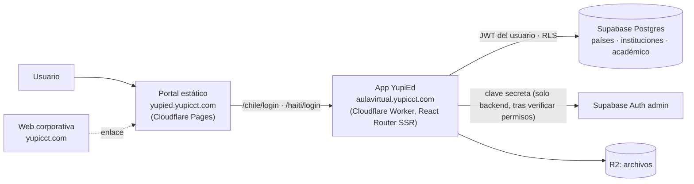
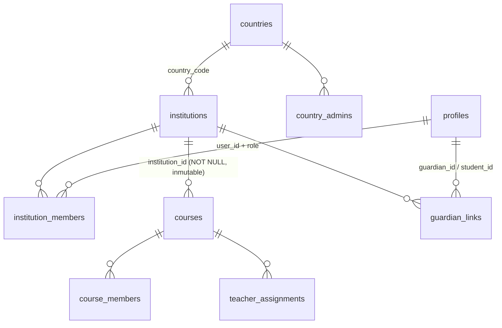
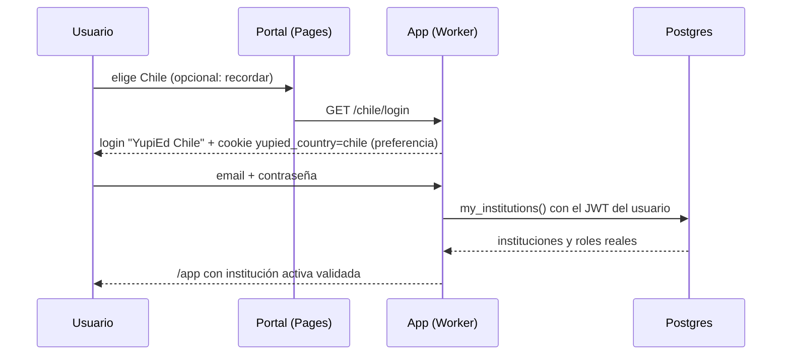

# Arquitectura internacional de YupiEd

YupiEd es el producto; **YUPICCT — Conciencia Tecnológica** es la empresa. Un solo código y una sola base de datos atienden a varios países; cada colegio/escuela es una **institución** aislada.

## Piezas

## Capas

| Capa | Dónde | Qué decide |
|---|---|---|
| Registro de países | `app/countries/<pais>/{config,academic-settings,localization,validation}.ts` + `public.countries` | Idiomas, moneda, zona horaria, formato de fecha, niveles, periodos, escala de notas, identificador nacional |
| Institución | `public.institutions` | Niveles que imparte, régimen de periodos, asistencia mínima, RUT/RBD |
| Pertenencia y rol | `public.institution_members`, `country_admins`, `guardian_links`, `user_roles` | Qué ve y qué puede hacer cada persona |
| Datos académicos | `courses.institution_id` → todo lo demás cuelga del curso | Aislamiento por herencia |

## Modelo de datos nuevo

## Flujo de entrada

La cookie de país solo es una **preferencia de interfaz** (marca, idioma por defecto, institución preferida). La autorización sale siempre de la base de datos.

## Roles

| Rol | Ámbito | Puede |
|---|---|---|
| superadmin | global (`user_roles`) | todo, activar/desactivar países |
| country_admin | país (`country_admins`) | crear/editar instituciones del país, nombrar admins de institución |
| institution_admin | institución | editar la institución, agregar personas (no otros admins), vincular apoderados, ver todo lo de su institución |
| director, inspector | institución | ver cursos, notas, asistencia y personas de su institución (solo lectura) |
| teacher | institución + cursos asignados | crear cursos en su institución y gestionar los suyos (como antes) |
| assistant | institución | asignable a cursos como apoyo |
| student | institución + cursos inscritos | como antes |
| guardian (apoderado) | institución + pupilos vinculados | ver notas y asistencia solo de sus pupilos |

## Rutas de la app

`/chile`, `/haiti` → guardan el país y llevan al login · `/chile/login`, `/haiti/login` → login con marca del país · `/chile/app`, `/haiti/app` → entrada directa · `/cambiar-pais` → borra la preferencia y vuelve al portal · `/app/admin`, `/app/admin/institutions/:id`, `/app/supervision`, `/app/guardian`.
